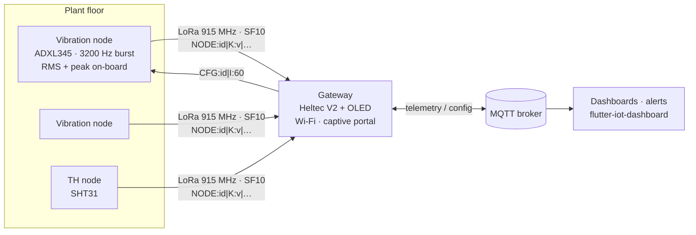

# iot-monitor-project: LoRa vibration & thermal monitoring

[](https://github.com/alveskevinn/iot-monitor-project/actions/workflows/ci.yml)


Condition monitoring for motors, pumps and cold storage over **LoRa point-to-point**. There is no LoRaWAN network server. Battery nodes measure **vibration** (ADXL345) or **temperature/humidity** (SHT31) and transmit across the plant floor. A single **gateway** forwards everything to **MQTT** and relays configuration back to the nodes.

```text
$ mosquitto_sub -t 'lora/#' -v
lora/_gateways/lora-gw-7c9e10/status online
lora/VB-07/telemetry {"node":"VB-07","gateway":"lora-gw-7c9e10","rssi":-97,"snr":7.5,"values":{"vib_rms_x_g":0.012,"vib_rms_y_g":0.009,"vib_rms_z_g":0.031,"vib_rms_g":0.034,"vib_peak_g":0.118,"sample_rate_hz":2710,"battery_pct":64,"seq":9}}
lora/TH-01/telemetry {"node":"TH-01","gateway":"lora-gw-7c9e10","rssi":-88,"snr":9.25,"values":{"temperature":23.41,"humidity":58.2,"battery_pct":87,"seq":1042}}
```

## Why

Most industrial sites have the same problem: the machines sit where Wi-Fi does not reach, behind concrete and steel and far from the office network. Pulling cable to every motor costs more than the monitoring is worth. LoRa at SF10 crosses a plant floor on a coin-sized antenna. Keeping the radio protocol point-to-point (no LoRaWAN network server, no per-device subscription) keeps the whole system on one gateway that writes into the customer's own MQTT broker.

## Architecture



| Piece | Source | What it does |
|---|---|---|
| TH node | [`firmware/src/th_node.cpp`](firmware/src/th_node.cpp) | temperature + humidity + battery every *N* s |
| Vibration node | [`firmware/src/vib_node.cpp`](firmware/src/vib_node.cpp) | 1024-sample burst. Single-pass AC RMS per axis, total RMS, peak, measured sample rate |
| Gateway | [`firmware/src/gateway.cpp`](firmware/src/gateway.cpp) | LoRa → JSON → MQTT, MQTT → LoRa downlink, OLED status, LWT |
| Protocol | [`firmware/lib/lora_packet`](firmware/lib/lora_packet) | parse/format uplinks and downlinks. Pure C++, unit-tested |
| Hardware | [`hardware/`](hardware) | BOM, wiring, reserved pins, radio settings, mounting guide |
| Build guide | [`web/index.html`](web/index.html) | interactive 3D viewer, wiring and BOM (PT-BR) |

### Why compute the vibration metrics on the node?

A LoRa frame at SF10 carries a few dozen bytes, and one second of raw 3-axis data at 3200 Hz is ~19 KB. So the node does the reduction itself: in one pass with O(1) memory, it removes gravity and offset (the mean) and reports **AC RMS** (the standard deviation per axis) and the **peak excursion**. Those are the quantities overall-level severity charts use (ISO 10816 / 20816 style). The measured sample rate is sent too, because I2C jitter makes the real rate drift below the nominal 3200 Hz.

### Protocol

| Direction | Frame | Example |
|---|---|---|
| uplink | `NODE:<id>\|<KEY>:<value>…` | `NODE:TH-01\|T:23.41\|U:58.20\|B:87\|N:1042` |
| downlink | `CFG:<id>\|I:<seconds>` | `CFG:VB-07\|I:60` |

The frames are plain text on purpose: any LoRa sniffer can read them, and they are easy to extend. `N` is a sequence number, so packet loss per node can be measured on the MQTT side. The gateway sends each downlink three times, because the nodes only listen between samples.

| Key | JSON field | Unit |
|---|---|---|
| `T` / `U` | `temperature` / `humidity` | °C / %RH |
| `RX` `RY` `RZ` / `RM` | `vib_rms_{x,y,z}_g` / `vib_rms_g` | g RMS |
| `PK` | `vib_peak_g` | g |
| `FS` | `sample_rate_hz` | Hz |
| `B` / `N` | `battery_pct` / `seq` | % / – |

## How to run

```bash
cd firmware
pio test -e native                  # protocol tests on your machine
pio run -e gateway  -t upload       # one gateway
pio run -e vib-node -t upload       # or th-node, one per sensor
pio device monitor                  # then type SETID:VB-07 to name the node
```

1. **Gateway:** on first boot it opens a Wi-Fi network named `lora-gw-XXXXXX`. Join it, pick your Wi-Fi network and enter the MQTT broker. Hold **PRG** during reset to reopen it.
2. **Nodes:** run `SETID:<id>` once over serial (stored in NVS, so every board runs the same image).
3. **Change the interval remotely:**

```bash
mosquitto_pub -t lora/VB-07/config -m '{"interval":60}'
```

Wiring, BOM and mounting are in [`hardware/README.md`](hardware/README.md).

## Roadmap

[Issues](https://github.com/alveskevinn/iot-monitor-project/issues) track the planned work: deep sleep on the TH node, AES-encrypted frames, FFT band energy on an ESP32-S3 node, and a Heltec V3 (SX1262) target.

## License

[MIT](LICENSE) © Kevin Pedroso · [DevSkin](https://devskin.com)
